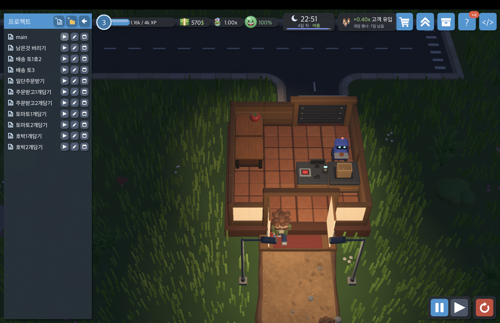

# 토마토와 호박



* 토마토와 호박만 파는 상태
* 매장 크기도 가장 작은 상태이다.
* while 문 말고는 사용할 수 있는게 없다.
* 효율적인 코딩을 하기 너무 어려운 상태

**결론**: 반자동!   
왼쪽 스크립트 재생 버튼을 내가 직접 눌러서 실행시킨다.   
간혹 로봇을 직접 움직여야 할 때도 있다.   
귀찮지만 코드 짜는 것도 귀찮아서 이 정도에서 타협..

여기에서 돈을 많이 벌어서 다음 단계에서는 효율적인 코드를 작성할 수 있길 희망.

## 내가 만든 스크립트

* **배송: 토마토1호박2** : 토마토1개와 호박 2개를 배송요청하고 배송이 될 때 까지 기다려서 물건 수령까지 한다.
* **배송: 토마토3** : 토마토3개를 배송요청하고 배송이 될 때 까지 기다려서 물건 수령까지 한다.
* **일단 주문받기** : 계산대 앞에 가서 일단 주문을 받는다.
* **토마토 1개 담기** : 로봇한테 토마토가 1개 있다고 가정한다. 장바구니에 가서 토마토 1개를 바구니에 넣는다.
* **토마토 2개 담기** : 로봇한테 토마토가 2개 있다고 가정한다. 장바구니에 가서 토마토 2개를 바구니에 넣는다.
* **호박 1개 담기** : 로봇한테 호박가 1개 있다고 가정한다. 장바구니에 가서 호박 1개를 바구니에 넣는다.
* **호박 2개 담기** : 로봇한테 호박가 2개 있다고 가정한다. 장바구니에 가서 호박 2개를 바구니에 넣는다.

## 코딩 방식

내 위치도 알 수 없고, `if`문도 쓸 수 없고, 뭐 할 수 있는게 없다.   
**일단 주문 받기**를 수행하기 위해서 일단 우측 상단으로 간 다음에 왼쪽, 아래로 내려오게 했다.   
다른 코드도 비슷한 식이다.

```
robot.Move(Direction.Right);
robot.Move(Direction.Right);
robot.Move(Direction.Right);
robot.Move(Direction.Left);
robot.Move(Direction.Down);

Order order = null;
while (order == null)
{
    order = robot.TakeOrder();
}
```

