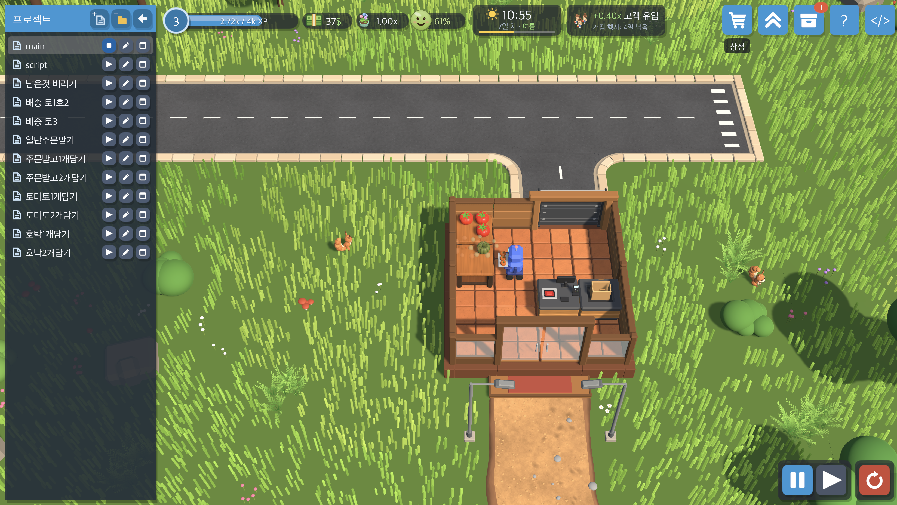
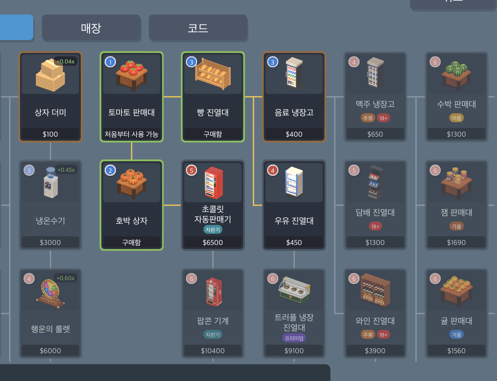

# 토마토와 호박 자동

* 매장 크기는 그대로
* 알아서 주문 받고 알아서 배달 시킨다.
* main 하나만 실행 시켜놓으면 된다.

## 후회하는 점

트럭과 진열대를 구매했다.   
하지만 그것은 실수였다.   
그것 없이도 어느정도 할 수 있고,   
정작 중요한 빵과 음료판매대를 놓지 못해서 고객 만족도가 깍여나간다.   

뭔가 매장에 놓으려면 업그레이드를 해야 하고,   
상점에서 그 판매대를 구입을 해야 한다.   
뭐 하나 놓으려면 400-500 은 기본으로 든다.

처음엔 돈을 아껴써야 한다. (그런데 끝까지 이럴 것 같다..)

## 레벨이 차면 되도록 업그레이드를 해두자.

각 업그레이드 왼쪽 상단 숫자가 있다.   
내가 그 레벨이 되면 고객은 내가 준비되었는지 확인도 안하고 주문을 날린다.   
당연히 제품을 제공해 줄 수 없으니 만족도가 깎였다.