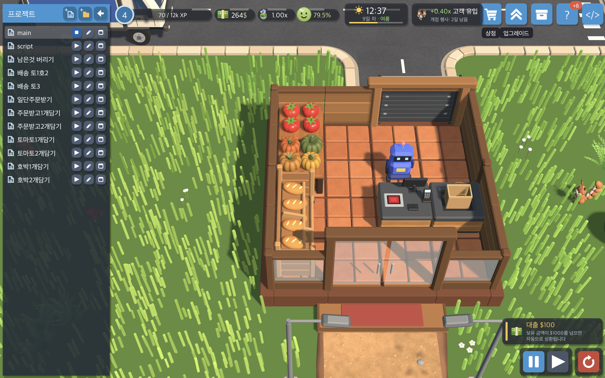
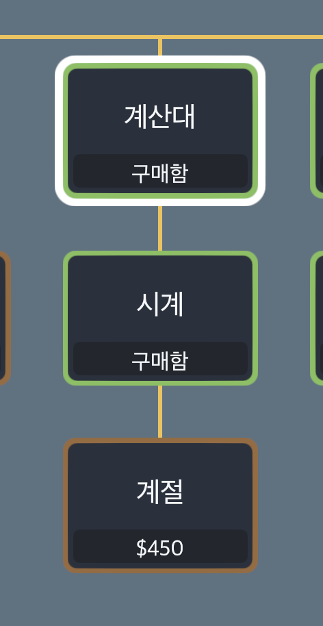
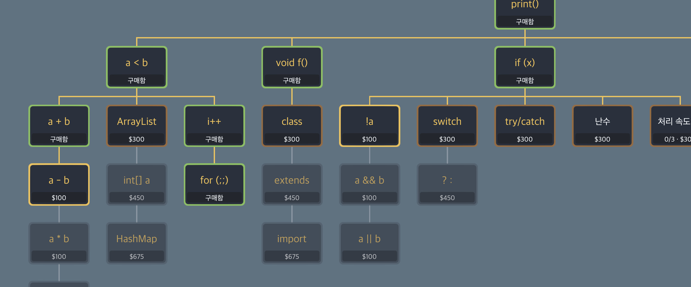

# 빵, 탄산!



내가 여기에서 일단 조금 망했다.   
판단을 잘 못 한 부분이 있었다.

일단 이 게임의 처음 적응하기 힘든 점은 업그레이드와 상점에서 구매하는 것의 차이를 이해하는 것이다.   
빵을 팔고 싶으면 빵 업그레이드만 하면 된다.   
"빵 진열대"는 필수가 아니다.   
그런데 난 "빵 진열대"가 필수인 줄 알고 그것을 구매했다.   
그래서 돈이 모자라서 탄산 업그레이드를 너무 늦게 했다.

고객의 만족도는 떨어졌고, 만족도는 수입에 영향을 준다.   
악순환에 빠져든다.

지금 코드는 빵은 진열대에서 꺼내고, 음료는 주문이 들어왔을 때 배송요청을 했다.

## 지금 자동화 수준

완전 자동화가 되었다.   
어느 정도 상식적인 움직임을 보인다.

```
while (true)
{
    주문을 받는다.
    주문이 없으면
        배달 위치에 가서 배송받을 물품이 있나 본다.
        (트럭이 안왔으면 가지 않는다.)
        물품이 있으면 선반에 놓는다.
        물품이 없으면 선반에서 부족한 수량을 배송요청한다.
    주문이 있으면
        while (주문을 모두 처리할 때 까지)
        {
            일단 내 손에 있는게 있으면 장바구니에 담는다.
            선반에서 물건을 들어서 장바구니에 담는다.
            배달 위치에 가서 배송받을 물품이 있나 본다.
            물품이 없으면 부족한 수량을 배송 요청한다.
            물품이 있으면 장바구니에 넣어주고 나머지는 선반에 넣는다.
        }
}
```


## 그래서 돈을 모아서 뭘 샀느냐.

다음 레벨에 술을 판다.   
밤에 미성년자에게 술을 팔면 안된다.   
시간을 알 수 있는 기능과, 고객의 나이를 알 수 있는 기능을 샀다.



계산대: 로봇이 계산대를 인식합니다. robot.isAtRegister()와 robot.isAtBag()로 화면 뒤인지 봉투 뒤인지 확인하고, robot.getCustomer()로 앞의 손님을 얻어 성인인지 확인합니다. robot.takeOrder()로 주문을 받습니다.

시계: 시간 확인: store.getHour(), store.getMinute(), store.getDay()로 시각과 날짜를 알아내 밤에 술을 팔지 않도록 합니다.

## 나중에 사도 된다고 생각하는 것



`ArrayList`, `class`, `extends`(상속), `import`(다른 파일 참조)   
이것들은 굳이 없어도 될 것 같기도 하다.   
로봇이 많아지면 필요할 것 같기도 하고..