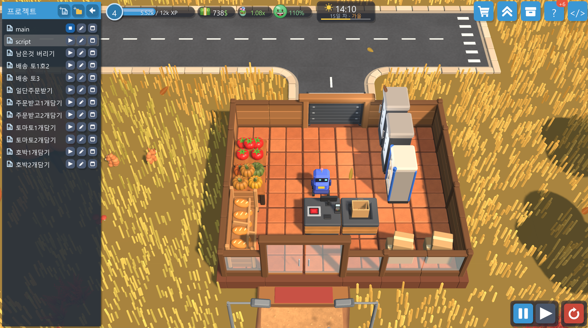
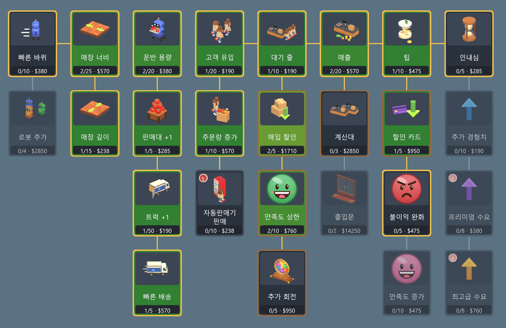
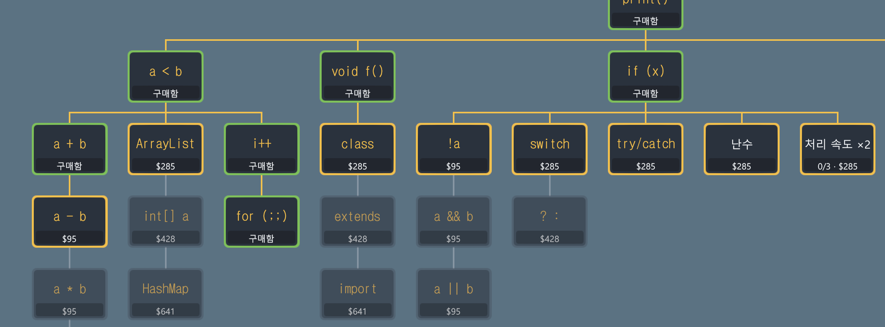
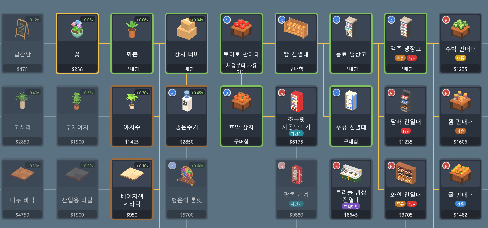

# 맥주, 우유



먼저 우유 업그레이드를 했다.   
우유 냉장고를 바로 사진 않았다.   
주문이 들어오면 그때그때 배송요청을 했다.

주문을 토대로 배송요청할 때 우유가 주문 목록에 있는지 먼저 확인하고,   
배송요청 목록에 우유를 추가하도록 했다.

```
/// <summary>선반에 부족한게 있으면 배송. 주문에 우유가 있으면 배송</summary>
void CallDeliveryNotEnoughFromShelfWithOrder(Order order)
{
    if (store.IsTruckAway())
    {
        robot.GetList().Clear();

        if (order.GetRemaining(Product.Milk) > 0)
        {
            for (var i = 0; i < order.GetRemaining(Product.Milk); i++)
            {
                robot.GetList().Add(Product.Milk);
            }
        }

        CountingNotEnoughFromShelf(Product.Tomato);
        CountingNotEnoughFromShelf(Product.Pumpkin);
        CountingNotEnoughFromShelf(Product.Bread);
        CountingNotEnoughFromShelf(Product.Soda);

        CallDelivery();
        robot.GetList().Clear();
    }
}
```


## 계산대와 시계 업그레이드

어린이에게 맥주를 팔면 큰일나기 때문에, 계산대 업그레이드를 먼저 했다.   
주문을 받은 뒤 성인체크부터 하도록 했다.

```
// main loop
// 주문을 받는다.
var order = TakeOrder();
if (order != null) // 주문이 있으면
{
    var customer = GetCustomer();
    RemoveAdultOnlyProduct(order, customer);
    // ...
}

/// <summary>미성년자는 맥주, 담배를 살 수 없다.</summary>
void RemoveAdultOnlyProduct(Order order, Customer customer)
{
    if (IsKids(customer))
    {
        RemoveItem(order, item => item.IsAdultsOnly());
    }
}
bool IsKids(Customer customer)
{
    if (customer != null)
    {
        if (customer.IsAdult() == false)
        {
            return true;
        }
    }
    return false;
}
void RemoveItem(Order order, Func<Product, bool> condition)
{
    var products = order.GetProducts();
    foreach (var item in products)
    {
        if (condition(item))
        {
            order.Remove(item);
        }
    }
}
```

이 글을 쓰면서 안 사실인데, 밤에는 주류를 팔면 안된다....   
어쩐지 돈이 안 벌리더라니..   
나는 and를 구매하지 않아서 이렇게 구현했다.   
해보니까 `lambda`도 되더라?! 이거 너무 좋은데?   
`Func<Product, bool>`로 `RemoveItem`을 구현했다.
```
/// <summary>밤에는 주류를 판매하면 안된다.</summary>
void RemoveAlcoholWhenNight(Order order)
{
    if (IsAlcoholAllowedTime() == false)
    {
        RemoveItem(order, item => item.IsAlcohol());
    }
}
bool IsAlcoholAllowedTime()
{
    var hour = store.GetHour();
    if (hour >= 6)
    {
        if (hour < 22)
        {
            return true;
        }
    }
    return false;
}
void RemoveItem(Order order, Func<Product, bool> condition)
{
    var products = order.GetProducts();
    foreach (var item in products)
    {
        if (condition(item))
        {
            order.Remove(item);
        }
    }
}
```

## 전반적인 업그레이드 방향

돈을 많이 버는쪽으로 계속 업그레이드했다.   



코드 업그레이드는 하지 않았다.   
여전히 `class`, `List`, `switch` 등은 쓰지 못한다.   
그렇게 불편하지 않다.   



서비스 업그레이드는 레벨에 맞게 해나가면 되고,   
돈을 많이 벌기 위해서 틈틈히 장식도 놓으려고 한다.

