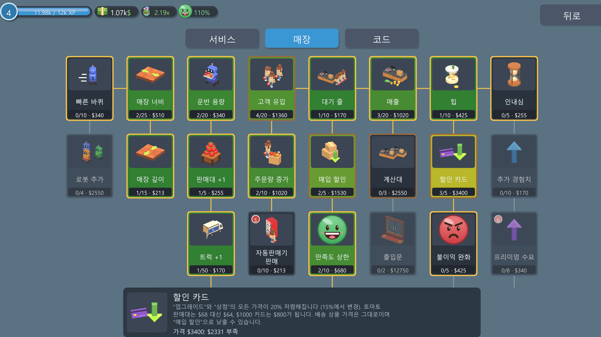
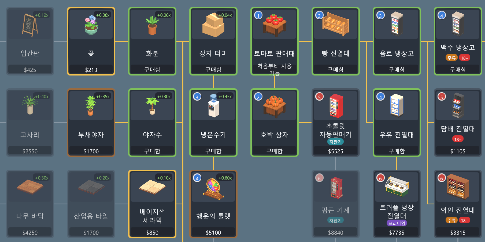

# 돈을 벌자.

코드 수정은 거의 하지 않고, 돈 버는 것에 집중했다.   
지출은 줄이고 수입은 늘린다.

매입할인, 만족도 상한, 매출도 업그레이드 했다.

## 할인카드



할인카드를 많이 샀다.   
비싼 냉온수기를 놓고 싶었다.   
할인을 많이 받으면 값이 싸지니까 돈을 모아서 샀다.

## 장식품



냉온수기를 샀다.   
야자수가 효율이 좋다는 것을 알았다.   
나는 치밀하게 계산하는 타입이 아니어서 적당히 좋아보이는 것을 사는 편이다.

## 선반 순회 방법

선반을 한쪽 방향으로만 순회를 했더니 마지막에 있던 우유는 재고가 잘 안채워지는 문제가 있었다.   
매 번 방향을 반대로 순회하도록 했다.

```
if (traverseReverse)
{
    CountingNotEnoughFromShelf(Product.Tomato);
    CountingNotEnoughFromShelf(Product.Pumpkin);
    CountingNotEnoughFromShelf(Product.Bread);
    CountingNotEnoughFromShelf(Product.Beer);
    CountingNotEnoughFromShelf(Product.Soda);
    CountingNotEnoughFromShelf(Product.Milk);
    traverseReverse = false;
}
else
{
    CountingNotEnoughFromShelf(Product.Milk);
    CountingNotEnoughFromShelf(Product.Soda);
    CountingNotEnoughFromShelf(Product.Beer);
    CountingNotEnoughFromShelf(Product.Bread);
    CountingNotEnoughFromShelf(Product.Pumpkin);
    CountingNotEnoughFromShelf(Product.Tomato);
    traverseReverse = true;
}
```

## 업그레이드도 코드로 할 수 있다면.
만약 업그레이드도 코드에서 할 수 있다면 정말 많은 계산을 했을 것 같다.   
예전에 개발자키우기 게임에서 해봤는데 재미있었다.   
최대 효율을 낼 수 있도록 업그레이드 하는 것이 은근히 머리를 많이 써야 하는 일이었다.

상점에서 뭔가 사서 배치하는 것도 코드로 할 수 있으면 좋겠다.

