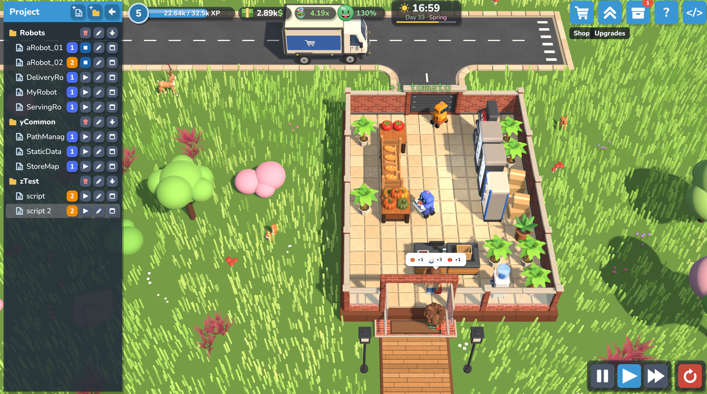
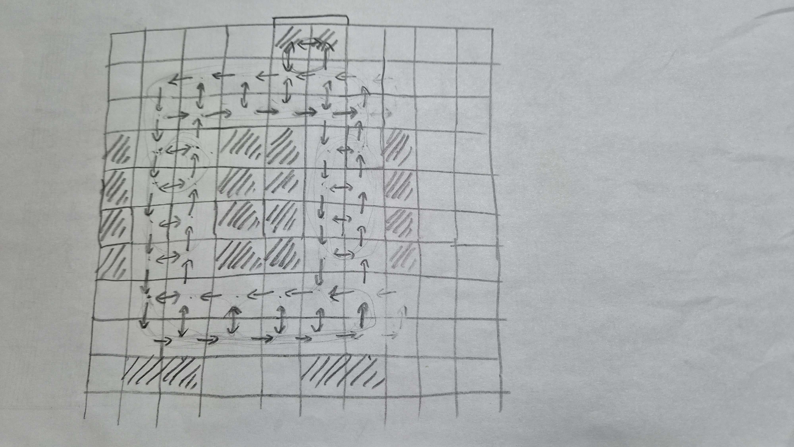

# 전반적인 재개발

지금까지 업그레이드 하지 않았던 C# 스킬을 업그레이드 했다.   
곧 로봇을 2개 써야 할 것 같아서 지금 재개발을 하기로 마음 먹었다.

## 로봇 2개 동작!

동영상 보러 가기: [YouTubeLink](https://youtu.be/icKbf24Dzpk?si=tjTNcrCV47Vbvsf3)

## 개발 방향

* 대규모 확장을 위한 설계
* 동선 설계: 주로 일방통행으로 움직인다
* 배송 요청할 때 진열대 앞으로 가지 않아도 되도록

## 설계

* StaticData: 상품을 업그레이드 했을 때 추가해야 할 최소한의 것들.   
주로 상품 목록.
* StoreMap: 상점의 주요 위치정보를 제공
* PathManager: 길을 잘 찾아 가도록 설계   
각 셀을 노드로 하는 그래프로 이동 가능한 셀을 제공
* 로봇 역할 분리: 서빙(캐셔)와 배송담당을 분리   
장기적으로 배송 담당은 1명, 서빙은 N명

## 로봇 역할

* Robot 01: ServingRobot   
주문을 받고 상품을 제공한다.
* Robot 02: DeliveryRobot   
진열대를 채우는 역할.

## 개발 결과

로봇 관련 로직은 거의 다 완성했다.

`PathManager`쪽은 전혀 진행하지 못했다.   
이번 설계는 여기서 마무리 하고,   
셀을 그래프 형태로 바꾸는 작업을 다음 설계를 목표로 할 계획.