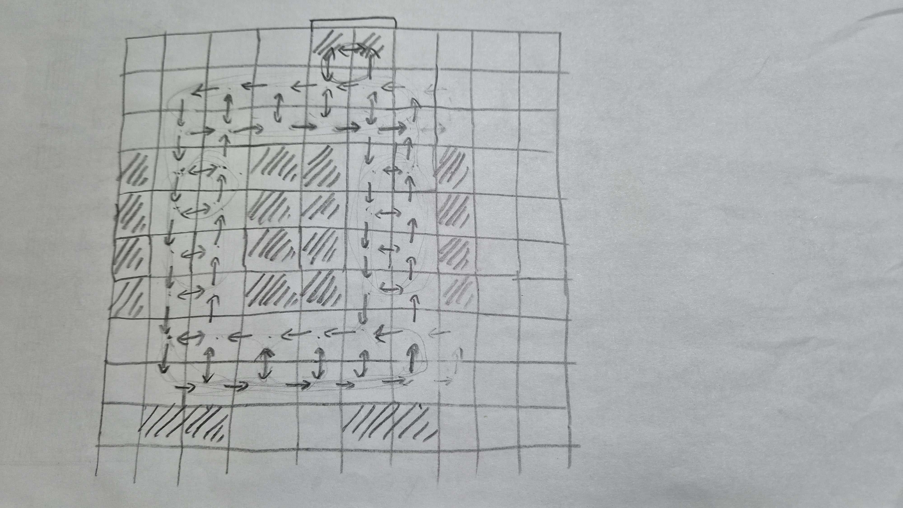
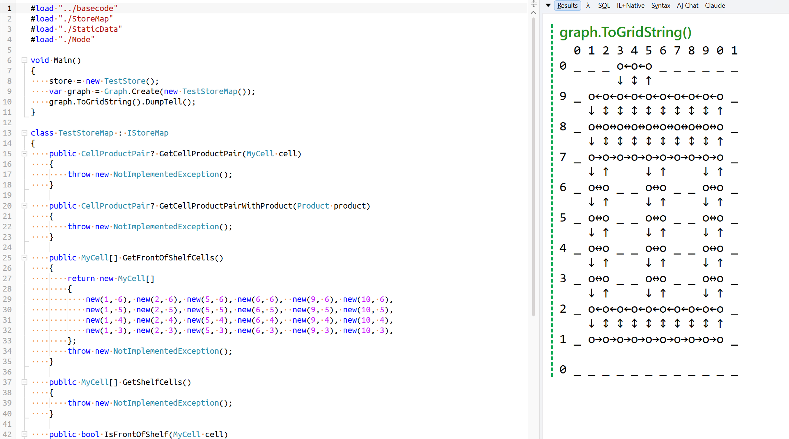

# 그래프

[07.Refactoring01](../07.%20Refactoring%201/README.md)에서는 움직임을 그냥 하드코딩했었다.   
좀 더 잘 할 수 있었지만, 일단 하드코딩으로 때우고,   
로봇 구현에 좀 더 집중했다.

## 동선 설계



빗금친 영역이 계산대이거나 선반(냉장고)이다.   
로봇은 반시계방향으로만 움직일 수 있다.   

## 그래프 구현

```csharp
// 이 안에는 코드마켓 컨텐츠 로직이 없다. 순수 길찾기를 위해 존재한다.
interface IGraph
{
    INode GetNode(int x, int y);
}

interface INode
{
    int X { get; }
    int Y { get; }

    /// 위로 올라갈 수 있는가? 객체가 있으면 갈 수 있다는 뜻.
    INode? Up { get; set; }
    INode? Down { get; set; }
    INode? Left { get; set; }
    INode? Right { get; set; }
    INode[] Next { get; }
}
```

`IStoreMap`으로 `IGraph`를 완성한다.   
내 지도는 기본적인 규칙이 있다.   
이런 규칙이 있어서 노드 만들기가 쉬운 편이었다.

* 계산대는 하단에 가로로 배치되어 있다.
* 선반과 냉장고는 2칸씩 건너띄어 놓는다.   
로봇이 반시계방향으로 이동할 수 있도록 세팅해 놓은 것이다.
* 배송 로봇도 반시계방향으로 움직인다.

## 테스트

[TestNode.linq](./TestNode.linq)에서 테스트 할 수 있다.



처음으로 linqpad에서 테스트 했다.   
`o`가 로봇이 지나다니는 셀이다.   
주요 모델을 interface로 설계해서 테스트 코드 만들기가 쉬웠다.   
게임에서 `store`라는 객체를 사용하는데,   
아래 코드 처럼 테스트 스토어를 쉽게 만들 수 있다.   
조금 더 발전하면 배송로봇, 서빙로봇 테스트도 할 수 있을 것 같다.
```csharp
store = new TestStore();
class TestStore : Store
{
    public List<Cell> FindAll(Entity entity)
    {
        return entity switch
        {
            Entity.Register => [new C(2, 0), new C(5, 0)],
            Entity.Bag => [new C(3, 0), new C(6, 0)],
            _ => [],
        };
    }
    public int GetWidth() => 12;
    public int GetHeight() => 11;
    public int GetGarageX() => 4;
    public int GetGarageY() => GetHeight() - 1;
    public bool IsFree(int x, int y) => true;
}
```

## 로봇 움직이기.

막상 하려고 하니까 어떻게 해야할지 감이 오지 않았다.   

### 배달 로봇

전략은 기존 로봇의 틀에서 크게 벗어나지 않으려고 한다.   
약간의 기본 룰은 넣어줄 계획.   

문제는 자판기이다.   
손님이 자판기에서 뭔가 사갈 수 있다.   
그래서 자판기는 손님 가까이 있다.   
어떤 동선을 만들어야 좋을지 잘 모르겠다.

### 서빙 로봇

자신의 구역을 지정할 수 있게 하려고 한다.   
`new ServingRobot(ShelfList shelfList)` 이런식이다.   
모든 서빙 로봇은 자신의 구역에 있는 물건을 모든 계산대에 제공해야한다.

## 예측 시스템?!

문득 든 생각인데, 손님이 주문할 물건을 미리 들고 있었다면 빠르게 처리할 수 있을 것 같다.   
일단 물건을 들고 손님을 맞이면 어떨까하는 생각이 들었다.